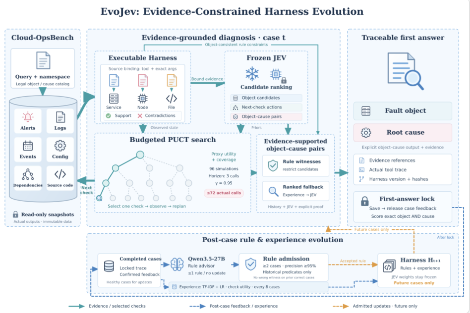

# EvoJev 方法说明

**一句话概括：EvoJev 用冻结的 JEV 分类模型引导树搜索获取证据，用可执行 Harness 验证根因，并在每题首答保存后让大模型提炼经过校验的经验，只改进后续题。**

[动态 README](../README.html) · [返回 README](../README.md) · [运行指南](reproduce.md)

## 整体流程

```text
当前题：公开问题 → 获取证据 ↔ JEV 排序与树搜索 → Harness 验证 → 保存首答
题后：  已完成轨迹 + 确认反馈 → LLM 提议规则 → 校验准入 → 下一题使用
```

JEV 负责排序，树搜索负责选择检查，Harness 负责验证证据，LLM 负责题后总结。JEV 权重始终冻结。



下面用真实案例 `case_0158` 串起八个模块。这是流中的第 389 题，使用 H82。示例是关键字段和输出的节选，不代表完整调用顺序。完整记录见[案例 JSON](case_walkthroughs.json)。

## 1. 接收问题

**原理。** 求解器只收到公开问题和合法候选，不收到当前题答案。已准入的历史 Harness 可以使用。

**输入。**

```json
{"query": "Service Availability Disruption.", "namespace": "boutique"}
```

**输出。** 这份服务可用性问题、H82 和合法对象目录交给采集模块。目录包含 `app/frontend`、`app/checkoutservice` 和 `node/worker-01` 等对象，但不标注谁是根因。

## 2. 采集并绑定证据

**原理。** 读取资源、告警、日志等工具快照，并按实际工具参数记录对象归属。不能把一个节点的日志归到另一个节点。

**输入。** 调用 `GetResources`，参数为 `resource_type=nodes` 和 `namespace=boutique`。

**输出。**

```json
{
  "id": "s2l2",
  "object": "node/worker-01",
  "text": "worker-01   NotReady                   node     143d   v1.31.2"
}
```

证据编号可回查原始输出。它交给 JEV 和搜索模块，说明节点值得检查，但 `NotReady` 还不能说明具体原因。

## 3. JEV 排序

**原理。** 分类模型根据问题、已采集证据和候选列表输出排序分数。分数用于决定先查谁，不是根因证明。

**输入。** 已看到 worker-01 为 `NotReady`，多个服务的 Pod 也启动异常。候选包括节点和这些应用。

**输出。** 本题真实轨迹保存的对象分数节选如下。

| 对象 | 排序分数 |
| --- | ---: |
| `node/worker-01` | 0.744 |
| `app/frontend` | 0.125 |
| `app/checkoutservice` | 0.092 |

这些分数让节点检查获得更高优先级。JEV 也参与动作和最终候选排序。系统可按已观察告警调整对象分数，因此不要把表中数值当作原始分类概率或正确率。

## 4. PUCT 树搜索

**原理。** 树的分支是检查动作。搜索结合 JEV 优先级和历史经验，平衡探索与预计的信息收益，选择最能区分竞争原因的检查。

**输入。** 轨迹步骤 32 前，剩余预算为 40 次，已有节点和服务证据。经验只来自此前完成的 384 个健康案例。

**输出。** 本次选中的实际动作如下。

```json
{
  "tool": "CheckNodeServiceStatus",
  "arguments": {"node_name": "worker-01", "service_name": "containerd"}
}
```

该动作返回 `inactive (dead)`。后续检查同一节点的 kubelet，发现它仍为 `active (running)`，但无法连接 containerd socket。新证据交给 Harness。

每次规划做 96 次代理模拟，最多向前考虑三个实际调用成本。模拟不读取未来工具输出或答案。每题最多调用 72 次实际工具，选中动作并获得真实输出后再规划。

## 5. Harness 验证与根因选择

**原理。** 可执行规则检查同一对象的正向证据和实际反证。它区分故障机制与下游症状，不把“没有检查”当作“已经排除”。

**输入。**

| 来源 | 同一节点上的观察 |
| --- | --- |
| `s32l4` | containerd 已停止。 |
| `s35l4` | kubelet 仍运行。 |
| `s35l14` | kubelet 连接 containerd socket 失败。 |

**输出。**

```json
{"fault_object": "node/worker-01", "root_cause": "containerd_unavailable"}
```

containerd 停止是直接证据，kubelet 仍运行有助于排除“kubelet 本身停止”。多个服务无法启动是影响表现。本题已有规则将候选约束为上述对象与原因对。

若仍有多个候选，就结合经验分数、JEV 分数和直接证据选择。没有完整证据时使用经验或 JEV 后备候选，不伪造证明。选出的预测交给保存模块。

## 6. 首答锁定

**原理。** 先不可覆盖地保存预测、轨迹、版本和哈希，再释放本题确认反馈。以后不能改写首答或回头重测。

**输入。** 上一模块选出的 `node/worker-01 | containerd_unavailable`。

**输出。** 本题实际顺序是保存首答、释放一致的确认反馈，再将已完成记录交给 LLM。反馈没有参与前面的诊断选择。

## 7. LLM 提炼规则

**原理。** Qwen3.5-27B 在题后提议一条可复用规则，或者返回 `no_update`。规则必须引用实际证据，不能按 case 编号或具体节点名查答案。

**输入。** 已锁定首答、containerd 停止与 socket 错误的证据，以及题后确认的根因。

**输出。** 本题提议可概括为以下条件，完整规则见案例 JSON。

```text
适用对象：任意节点。
正向条件：同一节点的 containerd 已停止，且 kubelet 日志报告 containerd socket 不存在。
反向条件：如果实际观察到 kubelet 也停止，这条规则不能直接支持结论。
支持原因：containerd_unavailable。
```

规则没有写死 worker-01，能够用于后续其他节点。提议交给校验模块，还不能直接生效。

## 8. 校验后，只向未来演进

**原理。** 检查格式、引用和对象归属，再匹配已完成案例的缓存证据。至少需要两个案例支持，见证精度不低于 95%，且不能在原本答对的历史题上产生错误根因见证。

**输入。** 上一模块的规则和截至本题已完成的 389 份记录。

**输出。** 本题提议获得 8 个历史案例支持，见证精度为 100%，没有在原本正确题上产生错误见证。因此 H82 更新为 H83，第 390 题起使用。当前题首答不变。

校验只匹配已有证据，不重新执行 JEV 或工具。历史准入通过也不保证所有未来题都不会退步。

另一条经验更新路径每八题刷新一次。它将已完成证据中的具体对象名归一化，再用 TF-IDF 和逻辑回归学习原因分布。例如，输入是“某节点的 containerd 停止”及确认原因，输出是通用特征和原因排序模型，不是 worker-01 的答案表。该经验辅助后续搜索，不替代直接证据。

## 准确率与边界

准确率是“健康首答的对象和原因都精确正确”的题数除以全部题目数。异常、缺失输出和只对一个字段都计错。

本轮结果为 **454 / 754 = 60.21%**。754 题各诊断一次，80% 目标未达到。这是在线首答成绩，不是用最终 Harness 重答旧题的成绩。公开 benchmark 此前已被本项目使用，不能称为项目级未见题测试。

大模型服务在第 458 道首答保存后从 16K 扩展到 256K 上下文。此前失败的更新没有补做，已保存首答未改变。

[案例 JSON](case_walkthroughs.json) 还包含镜像引用错误和源码忙等待两个例子。这三题用于解释方法，不能代表全量准确率。初始 Harness 借鉴 DeepSeek Harness 的插件设计，本项目不是直接运行其官方 Agent。
